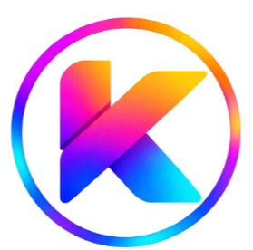

<div align="center">



# Agency CRM (Kreatiwit AgencyOS)

### The Open-Source Studio Command CRM for Digital Agencies, Consultancies & Creative Teams

[](https://opensource.org/licenses/MIT)
[](https://www.typescriptlang.org/)
[](https://react.dev/)
[](https://tailwindcss.com/)
[](https://supabase.com/)
[](https://bun.sh/)
[](tests/)

[**Live Demo**](https://crm-mnjo.vercel.app/) • [**Documentation**](#quickstart-in-60-seconds) • [**Architecture**](#architecture) • [**Database Schema**](#postgresql-schema--supabase-rls) • [**Contributing**](CONTRIBUTING.md)

</div>

---

## 🌟 Overview

**Agency CRM** is an end-to-end, open-source operational operating system engineered specifically for digital agencies, creative studios, software consultancies, and remote delivery teams. 

Unlike generic B2B sales CRMs that treat sales as an isolated funnel, **Agency CRM connects commercial deals directly to active production delivery, specialist capacity scheduling, department handoffs, executive approvals, and invoicing.**

Built with an **Awwwards-caliber light & dark visual system**, zero-flash theme persistence, Swiss typography (Plus Jakarta Sans + JetBrains Mono), and transactional PostgreSQL persistence with Row-Level Security (RLS).

---

## ⚡ Key Capabilities

### 1. 💼 Commercial Opportunity SKU Management
- **Monotonic Sequential SKUs:** Every converted lead or created opportunity receives a unique, collision-proof company-wide SKU tracking number (`KW-OPP-XXXXXX`), functioning like an SKU for creative services across all departments.
- **Idempotent Lead Conversion:** Atomically converts pipeline leads into client accounts and commercial opportunities without duplicating accounts or dropping records.
- **7-Stage Pipeline Drag-and-Drop:** Visual Kanban and dense tabular view across Discovery, Qualified, Proposal, Scoping, In Review, Closed Won, and Closed Lost.

### 2. 🚀 Projects & Operational Delivery Cockpit
- Real-time project tracking with delivery phases (Discovery, Strategy, Wireframing, High-Fidelity Design, Frontend, Backend, QA, Launch, Retainer).
- Health status velocity indicators (On Track, At Risk, Blocked).
- Multi-currency value tracking with multi-currency safety (INR, USD, EUR, GBP, AED).

### 3. 👥 Specialist Capacity & 24h Shift Intelligence
- Real-time 24h timeline coverage mapped across **IST shifts (UTC+5:30)**.
- Workload health and daily planned duty capacity calculation (`focus` vs `avail` with real-time `% Load`).
- Capability-based skill auto-suggestion: Automatically suggests best-fit team specialists for new projects based on required technology stacks.

### 4. 🔄 Department Transit Handoffs & Approvals
- Formal cross-department asset and deliverable handoffs (Sales ➔ Strategy ➔ Design ➔ Engineering ➔ QA ➔ Client Success).
- Executive Approval Center for milestone signoffs, change requests, and phase progression.
- Gated rejection workflows with explicit confirmation dialogs (`ConfirmModal`) preventing accidental rejections.

### 5. ⚖️ RACI Governance & Stage Gates
- Global interactive **RACI Governance Matrix** (Responsible, Accountable, Consulted, Informed) across key operational deliverables.
- Project stage gate checklists with phase-gate completion tracking.

### 6. 💳 Financial Statement Isolation & Invoicing
- Invoice generation and financial status tracking (Draft, Sent, Paid, Overdue).
- Executive financial statement isolation: `@media print` isolation ensures only the formal `#printable-statement` is captured during `window.print()`, hiding navigation rails and action bars.

### 7. 🛡️ High-Assurance Safety & Purge Protection
- Deletion in the Recycle & Archive module is guarded by a high-assurance confirmation gate requiring explicit keyword entry (`PURGE`) before destructive deletion is committed.
- Strict external link security: All parsed deliverable URLs enforce `target="_blank" rel="noopener noreferrer"`.

### 8. 🎨 Design System & Accessibility
- Awwwards-inspired light canvas (`#F8F8F8`) and deep obsidian dark canvas (`#0C100F`).
- Electric blue (`#49B3FC`) and studio jade (`#0D9488`) accent system.
- Zero-flash theme pre-hydration in HTML `<head>`.
- Responsive layouts engineered for Desktop (1440x900), Tablet (768x1024), and Mobile (390x844).

---

## 🚀 Quickstart in 60 Seconds

### Prerequisites
- [Bun](https://bun.sh/) (recommended) or [Node.js](https://nodejs.org/) v18+

### 1. Clone the repository
```bash
git clone https://github.com/IsmeetPandey/agency-crm.git
cd agency-crm
```

### 2. Install dependencies
```bash
bun install
# or: npm install / pnpm install
```

### 3. Configure environment
```bash
cp .env.example .env.local
```

*Note: Agency CRM includes an intelligent local fallback engine. If Supabase credentials are not configured, the app runs locally with full session persistence for immediate testing.*

### 4. Start the development server
```bash
bun run dev
```

Open [http://localhost:3000](http://localhost:3000) in your browser.

---

## 🗄️ PostgreSQL Schema & Supabase RLS

Agency CRM is built on a relational PostgreSQL database with Row-Level Security (RLS) enabled on all 16 business domain tables:

```
supabase/
├── migrations/
│   └── 20261102000000_initial_agencyos_schema.sql  # Full relational DDL, compound indexes & RLS
├── seed.sql                                         # Idempotent demo agency records
├── config.toml                                      # Supabase CLI local configuration
└── tests/
    └── database_test.sql                            # SQL test assertions
```

### Running with Local Supabase
```bash
# 1. Start local Supabase containers (Docker required)
bun x supabase start

# 2. Apply migrations and seed
bun x supabase db reset
```

### Production Supabase Cloud Setup
1. Create a new project at [supabase.com](https://supabase.com).
2. Copy your Project URL and Anon Public Key from **Project Settings ➔ API**.
3. Update `.env.local`:
   ```env
   VITE_SUPABASE_URL=https://your-project.supabase.co
   VITE_SUPABASE_ANON_KEY=eyJhbGciOi...
   ```
4. Run the migration script in Supabase SQL Editor from `supabase/migrations/20261102000000_initial_agencyos_schema.sql`.

---

## 📐 Architecture

```
src/
├── components/
│   ├── layout/
│   │   ├── Sidebar.tsx           # Collapsible desktop navigation (⌘B)
│   │   ├── Topbar.tsx            # Sticky topbar with mobile quick-actions (+) & search
│   │   └── CommandPalette.tsx    # Global ⌘K spotlight quick navigation
│   ├── modals/
│   │   ├── ConfirmModal.tsx      # High-assurance type-to-confirm modal barrier
│   │   ├── OpportunityModal.tsx  # Commercial deal modal with sequential SKU generator
│   │   ├── LeadModal.tsx         # Lead capture & conversion wizard
│   │   ├── ClientModal.tsx       # Client account creator
│   │   ├── ProjectModal.tsx      # Project setup with specialist auto-matching
│   │   ├── TaskModal.tsx         # Deliverable task assignment
│   │   ├── HandoffModal.tsx      # Cross-department transit modal
│   │   └── ScopeChangeModal.tsx  # Budget & timeline variance logger
│   └── ui/
│       ├── BrandMark.tsx         # Official Kreatiwit emblem & responsive wordmark
│       ├── OpportunityChip.tsx   # Interactive SKU tag component
│       └── ThemeToggle.tsx       # Zero-flash light/dark theme switch
├── features/
│   ├── dashboard/                # Operations cockpit, priority inbox & stage charts
│   ├── leads/                    # 6-stage sales pipeline with lead conversion
│   ├── opportunities/            # Commercial deals Kanban & dense table with SKU tracker
│   ├── clients/                  # Client accounts, contacts & linked deliverables
│   ├── contacts/                 # Stakeholder directory with account filters
│   ├── projects/                 # Projects masterboard, health velocity & detail cockpit
│   ├── tasks/                    # Task kanban board & assignee workload
│   ├── handoffs/                 # Department transit lanes with external link hardening
│   ├── finance/                  # Invoice ledger & print-isolated statement generator
│   ├── team/                     # 8-member roster, IST shift distribution & load %
│   ├── approvals/                # Approval center with confirmation barriers
│   ├── raci/                     # Global RACI governance matrix
│   ├── archive/                  # Recycle bin with purge security gates
│   └── settings/                 # Database latency tester, RBAC simulator & JSON backup
├── lib/
│   ├── auth/                     # Supabase Auth context with role enforcement
│   ├── permissions/              # Fail-closed RBAC matrix (Owner, Admin, Manager, Member)
│   ├── repositories/             # Typed data access layer with local fallback resilience
│   ├── services/                 # Authoritative backup & migration services
│   └── supabase/                 # Supabase client, database types & RPC wrappers
├── styles/
│   ├── theme.css                 # Awwwards light & dark CSS variable design tokens
│   └── index.css                 # Tailwind typography & print media directives
└── types/                        # Core TypeScript domain entities (16 modules)
```

---

## 🧪 Verification & Testing

Agency CRM maintains 100% test pass fidelity across all unit, integration, and security test suites:

```bash
# Run unit & integration test suite (38 tests)
bun test

# Run strict TypeScript compiler verification (0 errors)
bun run typecheck

# Run production bundle build
bun run build

# Run linter & code formatter (Biome)
bun run lint
```

### Test Coverage Highlights
- ✅ **Sequential SKU Allocation:** Monotonic sequence generation (`KW-OPP-XXXXXX`) with collision protection.
- ✅ **Idempotent Lead Conversion:** Non-duplicating conversion of leads into clients and opportunities.
- ✅ **Multi-Currency Safety:** Strict currency isolation preventing blended summation across diverse currencies.
- ✅ **RBAC Enforcement:** Authorization gates fail closed for unverified users or role impersonation.
- ✅ **Integrity Checks:** Foreign key validation preventing cross-client opportunity assignment.

---

## 📄 License

This project is licensed under the **MIT License** — see the [LICENSE](LICENSE) file for details.

---

## 🤝 Community & Contributing

Contributions are welcome! Please read our [Contributing Guide](CONTRIBUTING.md) and [Code of Conduct](CODE_OF_CONDUCT.md) before submitting pull requests.

Created with precision by [Ismeet Pandey](https://github.com/IsmeetPandey) and the **Kreatiwit AgencyOS Community**.
