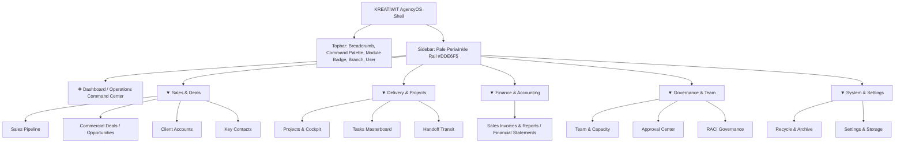

# Navigation Experience & Information Architecture Audit

**Target:** KREATIWIT AgencyOS Navigation Shell  
**Auditor:** Senior UX Architect  

---

## 1. Information Architecture Map

---

## 2. Navigation Usability Criteria & Verification

| Criteria | Expected Behavior | Observed Behavior | Status |
|---|---|---|---|
| **Location Awareness** | User always knows their current module | Topbar breadcrumb displays active view; sidebar link highlights with `#1A253C` and white text | **PASS** |
| **Accordion Persistence** | Parent group stays open when navigating child routes | `useEffect` auto-expands parent group whenever `view` changes | **PASS** |
| **Collapsed Group Cue** | When group is collapsed, active child still indicates parent | Parent button highlights in `#1A253C` with shadow if its child is the active route | **PASS** |
| **Direct Return** | Fast 1-click return to home dashboard | Top `❖ Dashboard` link is always visible above accordion groups | **PASS** |
| **Keyboard Command Palette** | Instant cross-module navigation | Pressing `⌘K` opens searchable command palette with shortcuts | **PASS** |
| **Mobile Drawer Ergonomics** | Smooth slide-over on small screens | Hamburger button triggers backdrop overlay drawer; clicking any link closes drawer automatically | **PASS** |

